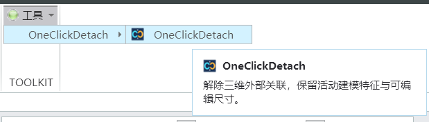
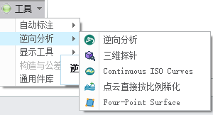
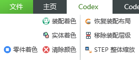

# Creo Plugin Skills

[中文介绍](README.zh-CN.md)

Reusable skills for AI-assisted Creo work: **connecting an AI agent to the right Creo session**, building Ribbon or menu plugins, switching versions, validating real commands, and packaging standalone plugins.

## Why I built this

While developing Creo plugins, I realized that explaining the requirement to AI was only the beginning. The time-consuming questions came afterward:

- The code is written—but does it compile?
- The DLL is built—but can Creo load it?
- The button appears—but are the labels and icons displayed correctly?
- It works on my computer—but will it work on another one?

After encountering these issues repeatedly, I started organizing the development workflow, checks, and lessons into **SKILLs** that could be reused. I mainly work with **Creo 12 and later**.

During more than 500 plugin-version iterations, I repeatedly had to stop the old plugin in Creo, remove its old registration, register the new version, start it, and close Auxiliary Applications before testing again.

Those repetitive clicks became exhausting. Writing code was only part of the work; getting the intended DLL into the right Creo session was another task every single time.

I collected that experience into these skills so an AI assistant can follow a repeatable workflow and, within an authorized update/test task, finish the runtime switch instead of handing the same manual steps back to me after every iteration.

These are skill instructions, references, scripts, and templates—not precompiled plugins or a bundled PTC SDK.

## Four skills

| Skill | Purpose | UI convention |
|---|---|---|
| [AI connection to Creo](skills/creo-ai-connection/SKILL.md) | Identify the target session and verify a CREOSON/MCP or native TOOLKIT connection | No UI required; read-first session checks |
| [Ribbon tab plugin](skills/creo-toolkit-ribbon-tab-plugin/SKILL.md) | Dedicated tabs and grouped commands | Uniform 16×16 icons plus Chinese labels; matching 32×32 resources |
| [Traditional menu plugin](skills/creo-toolkit-legacy-menu-plugin/SKILL.md) | Small utilities and compact command lists | Chinese text menus; icons are optional initially |
| [Extract and package](skills/creo-plugin-extract-package/SKILL.md) | Turn selected functionality into a shareable plugin | Required commands, resources, dependencies, and registration files only |

## Connect AI to Creo

The connection skill describes two paths: an existing local CREOSON service exposed to an AI client through MCP, or a version-matched asynchronous TOOLKIT/OTK controller for native operations. It checks service health, the exact Creo process and active model, then a read-only command before any authorized model change. With multiple Creo sessions, an ambiguous connection is a diagnostic result, not permission to modify a model. The skills ZIP contains instructions and references; install CREOSON or build the native controller separately for your own environment.

## Interface examples

Traditional menus can also have icons. The difference is where commands are organized: menus/submenus versus a dedicated Ribbon tab.

**Traditional menu examples**





**Ribbon tab example**



## Finish the iteration

```text
Identify the exact Creo session and target plugin
  → build a new versioned DLL
  → stop the old target application
  → remove its stopped obsolete registration when needed
  → register the current absolute protk.dat
  → start and confirm the intended new version
  → close Auxiliary Applications
  → run the actual menu/Ribbon command and verify the result
```

## Algorithm first, real button second

Validate CAD algorithms with an independent TOOLKIT test program connected to a clearly identified **real Creo test session**. Then integrate the tested implementation into the formal plugin and verify it from the actual button.

- **Algorithm validated:** the independent test produces the intended CAD result.
- **Plugin feature validated:** the real menu/Ribbon command completes the intended workflow.
- **Distribution validated:** the final package's own DAT, DLL, helpers, and resources pass the checks.

Compilation, initialization, and a visible button are not substitutes for a verified result. UI-only or registration-only changes should test their relevant paths without adding unrelated algorithm experiments.

## Versions and environment

My work began on Creo 12 and later, and the packaging skill now records SDK provenance and build evidence for older versions too. An older SDK build may work on a newer Creo, but compatibility must be verified on every target installation. Follow each plugin's tested-version information; this repository does not make every generated DLL universally compatible. PTC SDK archives are kept local and are not included here.

## Install

[Download the SKILLS package](Creo_Plugin_Skills.zip), attach it to **Codex**, and ask: **"Install these skills for me."**

## Contact

- Email: **zewei2580@gmail.com**

Maintained by [zewei2580-tech](https://github.com/zewei2580-tech).
